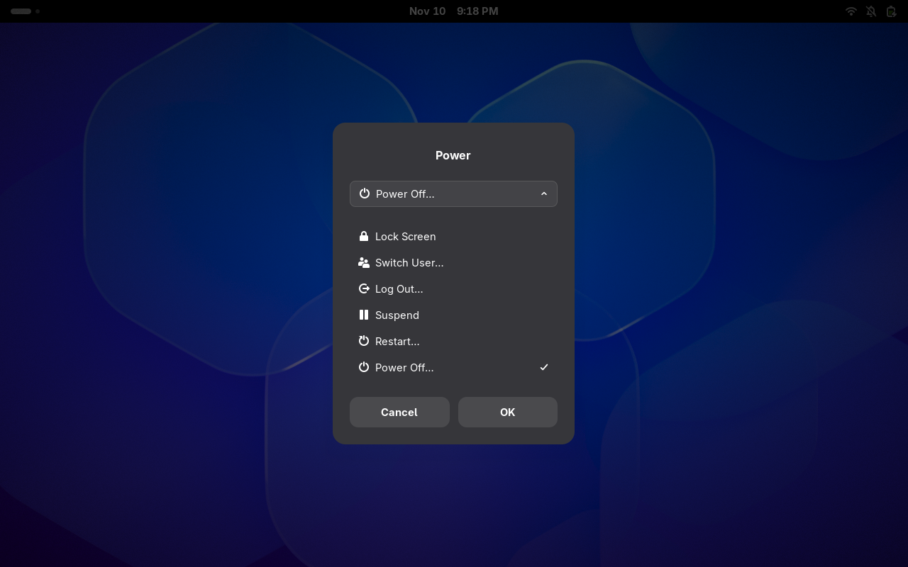

# Alt+F4 Power Menu



A GNOME Shell extension that brings Windows-style Alt+F4 behavior to GNOME:

- With an application focused, Alt+F4 closes the window as usual.
- On the desktop or in the overview, Alt+F4 opens a centered power menu.
- The last action you chose is preselected the next time the menu opens.
- Cancel or Escape closes the menu without changing that memory.

The menu shows a single action row with a dropdown, like the Windows 11 power
dialog. Up/Down changes the selected action at any time, Enter runs it, Space
or a click opens the dropdown, and Escape closes the menu. Picking an option
from the dropdown with the mouse also selects it.

It offers Lock Screen, Switch User…, Log Out…, Suspend, Restart…, and Power
Off…. It uses GNOME's own `SystemActions`, so unavailable actions are omitted
and GNOME's native confirmation dialogs are used.

## Requirements

- GNOME Shell 46–51
- Blur My Shell is optional

## Install

Install it from
[extensions.gnome.org](https://extensions.gnome.org/extension/11716/altf4-power-menu/).

Alternatively, download the zip from the
[latest release](https://github.com/AlphaBeast97/gnome-altf4-menu/releases/latest),
or build it with `npm run pack`, then run:

```bash
gnome-extensions install --force altf4-power-menu@alphabeast97.github.io.shell-extension.zip
```

Log out and back in so GNOME Shell discovers the new extension, then enable it:

```bash
gnome-extensions enable altf4-power-menu@alphabeast97.github.io
gnome-extensions info altf4-power-menu@alphabeast97.github.io
```

`gnome-extensions info` should report `State: ACTIVE`.

## Blur My Shell

No special configuration is needed. The menu is a standard GNOME Shell modal
dialog, so Blur My Shell's popup blur applies to it automatically when that BMS
option is enabled. With popup blur disabled, the normal theme background is
used.

## Development

```bash
npm ci
npm run lint
npm run test:unit
npm run pack
npm run test:smoke
```

`npm run test` runs lint, unit tests, and packing. `npm run test:smoke` loads
the packed extension in a temporary headless GNOME Shell session and checks
that it reaches `State: ACTIVE`.

`npm run pack` creates
`dist/altf4-power-menu@alphabeast97.github.io.shell-extension.zip`. The smoke
test is skipped with a clear message when the installed GNOME Shell does not
support headless mode.

Manual checks are listed in [docs/qa-checklist.md](docs/qa-checklist.md).

## License

GPL-3.0-or-later. See [LICENSE](LICENSE).
